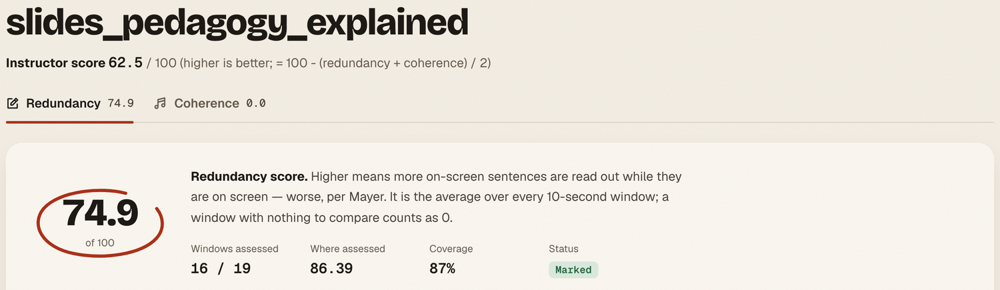
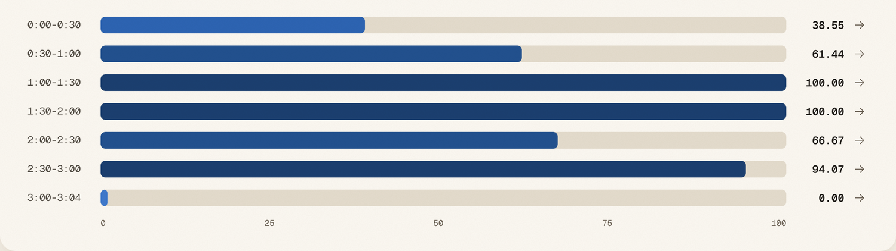
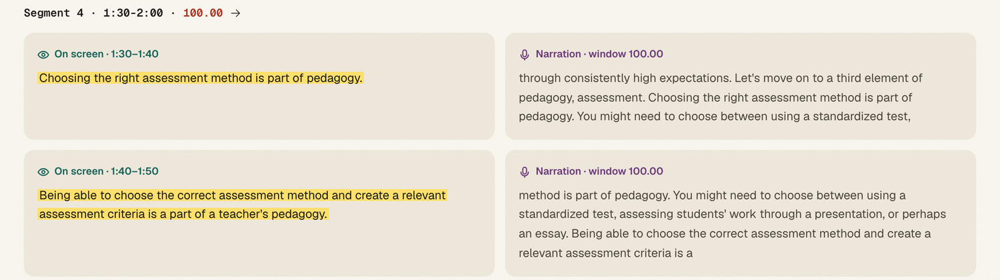
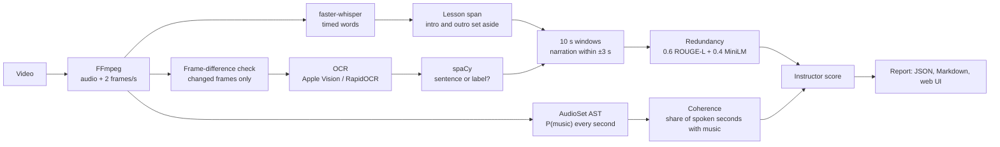

<div align="center">


<br>


**Does the screen just read the narration back to you?**
This project measures that, automatically, for any educational video, and shows its working.

[What it does](#what-it-does) ·
[See it](#see-it) ·
[How it works](#how-it-works) ·
[How the scores work](#how-the-scores-work) ·
[Does it agree with an expert?](#does-it-agree-with-an-expert) ·
[Get started](#get-started) ·
[Engineering](#engineering)

</div>

---

## What it does

Richard Mayer's research on multimedia learning shows that two design habits lower learning:
printing the narration on screen (**redundancy**) and playing music under it (part of
**coherence**). Checking a video for them normally needs an expert to watch every second. This
tool does it for you, and every number comes with its evidence: the on-screen text, the narration
it was compared with, the seconds of music, and the arithmetic.

| Score | What is measured | Range |
|---|---|---|
| **Redundancy** | on-screen *sentences* that the narration restates while they are on screen | 0–100, higher = worse |
| **Coherence** | background music playing under the narration (off-topic narration is measured and shown, but kept out of the score) | 0–100, higher = worse |
| **Instructor score** | `100 − (redundancy + coherence) / 2`, shown beside the two scores | 0–100, higher = better |

Titles, labels, key terms, aims, results and highlighted key lines are *signaling*, not redundancy,
and are never counted. The intro and outro of a video are not part of the lesson and are set aside.

## See it

A real report for a slide video that is read aloud (redundancy 74.9, coherence 0.0):

<p align="center"></p>

A score for every 30-second segment shows *where* the video repeats itself:

<p align="center"></p>

And the evidence shows *why*: each on-screen sentence beside the narration, repeated words highlighted:

<p align="center"></p>

## How it works



- **Each extraction stage runs in its own process.** This avoids native-library clashes between
  the speech and OCR stacks, frees each model's memory when its stage ends, and makes every stage
  independently resumable and inspectable.
- **Scoring is a plugin.** Each principle is one `PrincipleScorer` subclass that reads the shared
  windows (plus a per-video context of transcript and sound timeline).
- **Everything is logged.** Transcript, OCR dump, audio events, windows and per-window scores are
  written to a per-run folder, so any score can be audited.

## How the scores work

Both principles use 10-second windows and roll up the same way: a duration-weighted mean over
**all** windows, where a window with nothing to assess counts as 0. A video's score is therefore
exactly the mean of its 30-second segment scores.

**Redundancy.** Only on-screen text classified as a full sentence counts (a finite verb with a
subject; titles and labels are signaling). A sentence scores above 0 only if the narration actually
**restates** it: says more than half of its content words, and more of them than narration elsewhere
in the video does by chance. Above that gate, two measures are taken, each above chance, and
combined:

```
sentence score = 0.6 × verbatim + 0.4 × semantic
verbatim = share of the on-screen words the narration says, in order   (ROUGE-L)
semantic = cosine similarity to the best-matching narration sentence    (all-MiniLM-L6-v2)
```

A sentence is compared with the narration spoken while it is on screen (±3 s), and a window's score
is the time-weighted mean of what is on screen. Captions that run one sentence across several
screens are joined back into whole sentences first.

**Coherence.** The share of spoken seconds with music under them, from an AudioSet sound classifier
(`MIT/ast-finetuned-audioset-10-10-0.4593`, probability ≥ 0.3). Music with nobody speaking, such as
an intro jingle, is recorded but not counted.

A video with no narration at all scores **N/A, not 0**: it could not be assessed.

Every threshold and weight is in [`config.yaml`](config.yaml), with the reasoning behind each value
written next to it. None was tuned against the expert's ratings.

## Does it agree with an expert?

The system was **frozen before** one expert's manual ratings were opened (the configuration, scores,
expectations and source code were fingerprinted first), then validated without tuning anything. The
expert rated nine videos in 30-second segments, without seeing the system's scores. Agreement is
Spearman's rank correlation, with 95% intervals from a bootstrap that resamples whole videos.

| Redundancy vs the expert | Spearman ρ | 95% CI |
|---|---:|---|
| per video (9 videos) | **0.90** | 0.56 – 1.00 |
| per 30 s segment (57 segments) | **0.70** | 0.41 – 0.83 |

Read this honestly: it is **one rater and nine videos**, so the intervals are wide, and a stronger
test needs two to four independent raters. The coherence score is **not validated**: the expert's
rating covers several kinds of extraneous material and the system scores only music. Five attempts
to detect decorative pictures failed a pass test that was fixed in advance, so pictures are not
scored. The ratings themselves are private research data and are not part of this repository.

## Get started

Requires Python 3.11+ and ffmpeg. Developed on macOS (the default OCR backend uses Apple's Vision
framework; set `ocr.backend: rapidocr` in `config.yaml` elsewhere).

```bash
brew install ffmpeg python@3.11 uv
uv venv --python "$(brew --prefix python@3.11)/bin/python3.11" .venv
uv pip install --python .venv/bin/python -e '.[dev,webapp]'
uv pip install --python .venv/bin/python "en_core_web_trf @ https://github.com/explosion/spacy-models/releases/download/en_core_web_trf-3.8.0/en_core_web_trf-3.8.0-py3-none-any.whl"
```

The first run downloads model weights: Whisper `small`, MiniLM sentence embeddings, and the AudioSet
sound classifier (about 1.4 GB in total). After that, scoring runs offline.

```bash
mmpquant config-check                 # validate config.yaml
mmpquant score  path/to/video.mp4     # extract, score both principles, write the report
mmpquant report runs/<video_id>       # re-render report.md from a run
mmpquant serve                        # web UI at http://127.0.0.1:8000
mmpquant regress                      # re-score the corpus and check the expectations
mmpquant validate                     # system vs manual scores (when they exist)
```

A 3-minute video takes about 3–4 minutes on an Apple M2 laptop (CPU only).

<details>
<summary><b>What a run writes</b></summary>

Each run writes to `runs/<video_id>/`:

| file | contents |
|---|---|
| `transcript.json` | narration with word-level timestamps (faster-whisper) |
| `ocr.json` | on-screen text, de-duplicated across static frames |
| `audio_events.json` | sound classes heard, second by second (coherence) |
| `windows.json` | narration and on-screen text aligned per 10-second window |
| `result.json` | every window's score with its evidence, both principles, and the full config used |
| `report.md` | human-readable report: scores, segment timelines, worst segments, methodology |
| `segment_scores.csv`, `coherence_segment_scores.csv` | per-segment scores for comparison with human ratings |

Re-running reuses the saved transcript, OCR and audio events, so changing a scoring parameter
re-scores in about a minute. Use `--no-resume` to recompute them.

</details>

<details>
<summary><b>Validation harness</b></summary>

`validate` reads the manual scores named in `config.yaml` (a CSV, or a folder of filled-in annotation
sheets; one score per video or per segment; one or more raters), joins them with each video's run,
and reports Spearman with a 95% bootstrap interval, rater agreement, and the largest
disagreements. The method was fixed before any manual score was seen: the comparisons are the
pre-registered variants of each score.

</details>

## Engineering

- **608 unit tests** (about 25 s, no model downloads) and **20 browser tests** of the web UI. The
  scorers take their models by dependency injection, so the scoring rules are tested against
  hand-computed values with synthetic text, transcripts and sound timelines.
- **A regression loop** (`tools/loop_check.sh`): lint, unit tests, browser tests, then
  `mmpquant regress`, which re-scores every video, checks 28 expectations that each came from a
  problem found by hand, and lists every score that moved against an accepted baseline. Score
  changes are accepted by a person, never automatically.
- **Sabotage-verified fixes.** Each fix has a test that fails when the fix is undone.
- **One configuration file.** All tunable parameters live in `config.yaml`, and the exact file is
  copied into every run's `result.json`.

```
src/mmpquant/
├── extract/        ffmpeg, ASR, OCR (Apple Vision, RapidOCR), audio events, alignment, captions
├── scoring/        redundancy.py, coherence.py, the PrincipleScorer plugin base
├── onscreen.py     layout, sentence-or-label classification, signaling rules
├── lesson_span.py  intro and outro detection
├── instructor.py   the combined score
├── segments.py     window → segment → video roll-up
├── validation/     ground truth, statistics, harness
└── webapp/         FastAPI server (React front end in webapp-react/)
```

## Notes

- Videos and run outputs are not in this repository (`data/videos/` and `runs/` are ignored): the
  sample videos belong to their creators.
- Code comments sometimes cite `PROGRESS.md`, the author's private research log. It is not included
  here.
